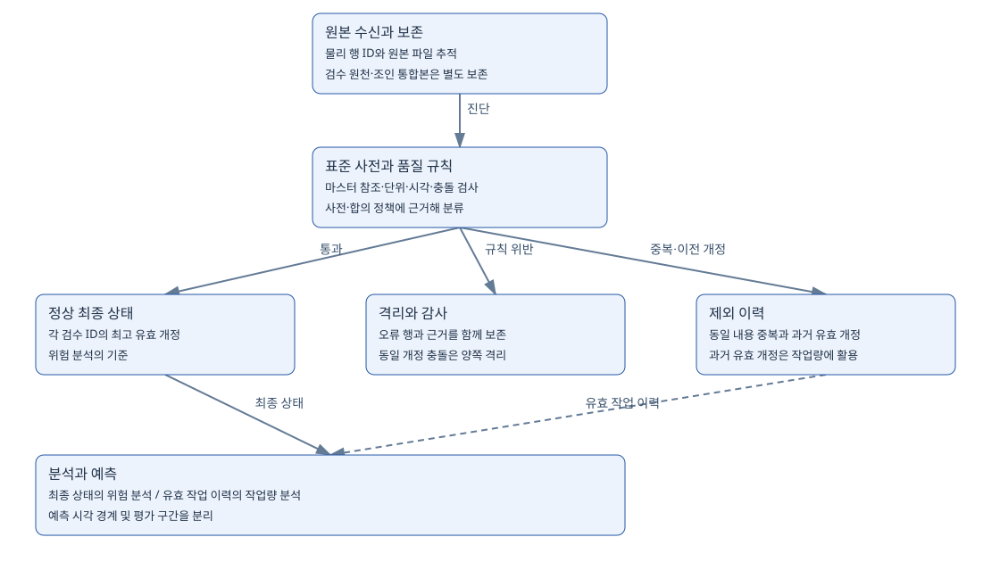
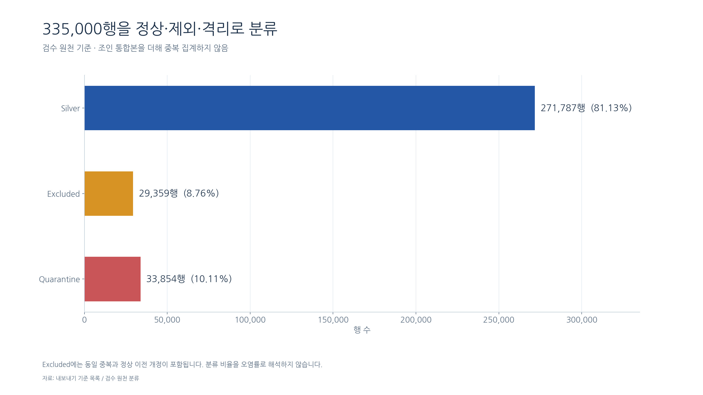
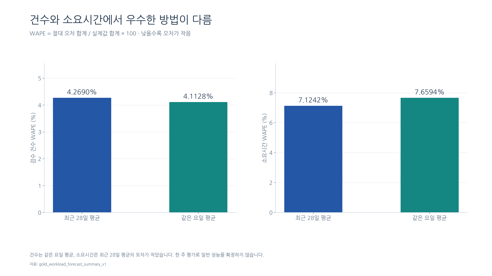

<p align="center">
  
</p>

# KREAM · 레거시 검수 데이터 표준화와 운영 개선 분석

**오염된 검수 기록을 표준화하고, 검증 가능한 데이터 모델과 운영 개선의 근거로 연결한 AI Ready Data 팀 프로젝트입니다.**

상대팀에서 제공받은 KREAM 스타일의 합성 검수 데이터를 대상으로 **AS-IS 진단 → 표준 사전 → TO-BE 모델 → MySQL 정제·적재 → SQL·Pandas 검증 → Gold 분석**을 수행했습니다. 실제 기업의 운영 실적이나 공식 품질 지표를 분석한 자료는 아닙니다.

| 원본 검수 | 최종 정상 검수 | 원본 행 대사 | 독립 검증 |
| ---: | ---: | --- | --- |
| **335,000행** | **271,787건** | 정상·격리·제외 합계 일치 | **Pandas 482개 검사에서 실패 0개** |

> 검증 기준일: **2026.10.15**. 482개는 실행한 규칙의 범위입니다. SQL 품질 스냅샷의 14개 통과·1개 미검증·1개 기준 차이 기록은 별도로 공개합니다.

## 목차

1. [프로젝트 배경과 목표](#01-overview)
2. [데이터와 분석 범위](#02-data)
3. [전체 처리 구조](#03-pipeline)
4. [AS-IS 품질 진단](#04-profiling)
5. [표준 사전과 정제 정책](#05-standard)
6. [최종 ERD와 TO-BE 모델·데이터 이력](#06-model)
7. [정제 결과와 검증](#07-validation)
8. [운영 개선 분석](#08-analysis)
9. [Gold 모델과 작업량 예측](#09-gold)
10. [재현성과 실행 방법](#10-reproduce)
11. [사용 기술과 역할](#11-stack)
12. [산출물·저장소 구성](#12-deliverables)
13. [설계 판단과 개선 과제](#13-decisions)

<a id="01-overview"></a>
## 1. 프로젝트 배경과 목표

리셀 플랫폼의 검수 기록에는 상품명 별칭, ID 표기 차이, 혼합된 날짜·금액 단위, 잘못 연결된 직원 정보, 중복과 개정 충돌이 함께 들어 있습니다. 이런 기록을 그대로 합산하면 상품별 위험, 부서별 작업량, 배상금 모두 잘못 계산될 수 있습니다.

이 프로젝트는 서로 교환한 레거시 데이터와 명세서를 바탕으로 다음 문제를 해결하는 것을 목표로 했습니다.

| 과제 | 수행 내용 | 산출물 |
| --- | --- | --- |
| 현행 상태 진단 | 원본 CSV의 결측·중복·형식·참조·개정 충돌 수치화 | AS-IS 프로파일링 보고서 |
| 표준 정의 | 단어·용어·도메인·코드·명명 규칙 정의 | AI 데이터 표준 사전 |
| 모델 설계 | 마스터·검수 현재 상태·감사 이력·분석 모델 분리 | 개념·논리·물리 ERD와 TO-BE 명세 |
| 변환과 검증 | 명세서에 따른 정제·적재, 원본 추적과 정합성 검사 | 변환 SQL, 검증 CSV·보고서 |
| 분석 활용 | 품질 위험·재검수 부담·품목 배정·작업량 확인 | Gold 테이블과 시각화 |

AI Ready의 초점은 **이름·형식·단위·코드가 일관되고, 출처와 처리 근거를 추적할 수 있는 데이터**를 만드는 데 두었습니다. 특정 AI 모델의 성능 향상을 검증한 프로젝트로 표현하지 않습니다.

<a id="02-data"></a>
## 2. 데이터와 분석 범위

### 공급받은 원본

| 파일 | 역할 | 물리 행 수 | 업무 컬럼 수 |
| --- | --- | ---: | ---: |
| `kream_product_std_dict.csv` | 상품·판정·부서 코드, 동의어와 금지 값 기준 | 32 | 8 |
| `kream_category_parent_lookup.csv` | 카테고리 기준 정보 | 1,050 | 4 |
| `kream_inspector_master.csv` | 검수원 사번·현재 소속·직급·재직여부 | 3,150 | 6 |
| `kream_inspection_300000.csv` | 원천 검수와 개정 기록 | 335,000 | 13 |
| `kream_inspection_join_ready.csv` | 마스터 정보와 배상금이 붙은 조인 통합본 | 335,000 | 18 |
| **합계** | **5개 파일** | **674,232** | **49** |

**674,232는 파일별 물리 행 수의 합입니다.** 원천 검수와 조인 통합본은 같은 업무의 별도 표현이므로 670,000개의 서로 다른 검수로 합산하지 않습니다. 파일명에 `300000`이 있지만 원천의 실제 수신량은 중복·개정 등을 포함한 335,000행입니다.

### 분석에서 구분한 단위

| 구분 | 단위와 의미 |
| --- | --- |
| 원본 물리 행 | 파일에 실제 수신한 한 행. 원본 행 번호로 추적 |
| 검수 현재 상태 | `INSP_ID`별 마지막 유효 개정 한 건 |
| 유효 작업 이력 | 중복·오류를 제외한 최초·재검수 각각의 작업 기록 |
| 상품 | 모델 코드 기준의 상품 종류. 개별 실물의 고유 식별자와 다름 |
| 부서 | 정상 검수원 마스터의 현재 소속. 검사 당시 부서 이력과 구분 |

<a id="03-pipeline"></a>
## 3. 전체 처리 구조



MySQL에 Bronze·Silver·Gold 레이어를 테이블로 구현했습니다. 오류 데이터와 제외 이력도 별도 테이블에 보관합니다.

| 영역 | 역할 | 핵심 처리 |
| --- | --- | --- |
| Bronze | 공급 원본 보존 | 업무 값을 문자열로 적재하고 원본 파일·행 번호 유지 |
| AS-IS 검사 | 규칙별 진단과 후보 값 생성 | ID·날짜·수치·상품명·마스터 참조·개정 충돌 검사 |
| Silver | 정상 마스터와 최종 유효 검수 | 표준화, 근거 있는 복구, 최고 유효 개정 선택, 재조인 |
| Quarantine | 오류 기록 격리 | 원본·후보 값·오류 플래그·격리 사유 보존 |
| Excluded | 동일 중복과 이전 유효 개정 보관 | 현재 상태에서는 제외하고 이력과 감사에 활용 |
| Gold | 분석·예측에 맞는 집계 | 최종 상태의 위험 분석과 유효 이력의 작업량 분석 구분 |

실행 중 조사·보완 과정을 거친 SQL 원본은 `sql/archive/`에 보관했고, 새 스키마에서 재실행하도록 정리한 파일은 `sql/repro/`로 구분했습니다.

<a id="04-profiling"></a>
## 4. AS-IS 품질 진단

원본 CSV를 Pandas로 직접 읽고, 기존 SQL 진단과 대조했습니다. 원문을 읽을 때 빈 문자열과 문자 그대로의 `NULL`을 자동 결측으로 바꾸지 않았습니다.

| 발견한 문제 | 원본 진단 수치 | 분석에 미치는 영향 |
| --- | ---: | --- |
| 동일 검수·동일 개정의 내용 충돌 | 2,400개 그룹 / 4,800행 | 어느 한쪽을 최신 정상으로 임의 선택할 수 없음 |
| 검수 완료가 입고보다 빠름 | 3,165행 | 검수 선후 관계와 소요 흐름 왜곡 |
| 추출 시각이 완료보다 빠름 | 2,891행 | 처리 시점과 예측 입력 시점의 모순 |
| 거래금액 결측 | 591행 | 거래금액·배상금 계산 불가 |
| 거래금액 음수 | 609행 | 정상 금액 범위 위반 |
| 검수 소요시간 `-999` | 1,200행 | 정상 시간처럼 집계하면 작업량 왜곡 |
| 검수 ID 표기 정규화 대상 | 6,000행 | 같은 ID가 다른 값으로 인식될 수 있음 |
| 검수원 사번 표기 정규화 대상 | 6,000행 | 마스터 연결 누락 가능 |
| 표준 상품명과 원문 불일치 | 17,100행 | 같은 상품의 집계가 분리될 수 있음 |
| 재직여부가 정확한 `Y`, `N` 이외의 값 | 320행 | 허용 코드 혼용 |

문제 유형은 같은 행에 중첩될 수 있습니다. **위 건수를 더해 전체 오염 행 수로 해석하지 않습니다.** 상품명 불일치에는 사전과 코드로 복구 가능한 후보도 포함됩니다.

원천 검수의 네 판정 코드는 이미 표준 값이었습니다. 사전의 허용 별칭과 원본에서 실제 발생한 변환 건수를 구분해, 관측하지 않은 판정 변환을 정제 실적으로 세지 않았습니다.

- [컬럼별 원본 프로파일](reports/bronze/asis_column_profile.csv)
- [원본 품질 문제별 상세 진단](reports/bronze/asis_business_diagnosis.csv)
- [SQL과 Pandas 진단 비교](reports/bronze/sql_pandas_comparison.csv)
- [AS-IS 프로파일링 보고서](reports/asis_profiling_report.html)

<a id="05-standard"></a>
## 5. 표준 사전과 정제 정책

### AI 데이터 표준 사전

| 구성 | 수량 | 정의한 내용 |
| --- | ---: | --- |
| 표준 단어 | 149개 | 이름을 구성하는 기본 단어와 약어 |
| 표준 용어 | 189개 | 업무 의미를 가진 표준 용어 |
| 타입 도메인 | 43개 | 자료형·길이·수치 범위 등 |
| 공식 코드 | 32행 | 상품·판정·부서·금지 값의 기준 |
| 전체 컬럼 매핑 | 393개 | 문서화 대상의 실제 컬럼과 표준 정의 연결 |

공식 코드 32행과 전체 표준 사전을 구분합니다. 393개 매핑에는 감사·추적·검증 컬럼도 포함되며 원본의 서로 다른 업무 컬럼 수를 뜻하지 않습니다.

명명 규칙은 등록 단어 조합, 밑줄 구분, 식별자·단위·비율·시각의 의미를 기준으로 정리했습니다. 기존 물리명을 임의로 일괄 변경하지 않고 논리 표준명과 대응시켜 SQL과 결과의 연결을 유지했습니다.

- [단어](dictionaries/standard_words.csv) · [용어](dictionaries/standard_terms.csv) · [타입 도메인](dictionaries/standard_domains.csv)
- [업무 허용값](dictionaries/business_domains.csv) · [공식 코드](dictionaries/standard_codes.csv) · [컬럼 매핑](dictionaries/column_standard_mapping.csv)

### 핵심 업무 규칙

| 대상 | 적용한 처리 |
| --- | --- |
| ID | 명세와 확정 규칙에 따른 공백·전각 등 표기 정규화 |
| 상품명 | 유효 상품 코드·사전 표준명·동의어를 근거로 복구 |
| 사번 조인 | 이름 대신 사번으로 정상 검수원 마스터와 연결 |
| 카테고리 | 정상 카테고리 마스터와 확인된 상품 매핑 근거 사용 |
| 날짜·시간 | 시간대 누락은 KST, UTC 표기는 KST로 변환 |
| 시간 순서 | 입고 ≤ 검수 완료 ≤ 추출을 확인하고 역전 행 격리 |
| 금액 | 정의된 단위 해석, USD는 1,350원 고정 환율, 소수 보존 |
| 소요시간 | 초를 분으로 통일, 결측·음수·`-999` 등 오류 격리 |
| 재직여부 | 원본이 정확한 대문자 `Y`일 때만 재직, 나머지는 `N` |
| 동일 개정 충돌 | 충돌한 양쪽 행 모두 격리 |
| 최신 개정 오류 | 오류 행을 격리하고 최고 유효 개정 선택 |
| 가품 오판정 배상금 | `CLAIM_FAKE_PASS`이면 거래가 × 3, 그 외 0 |
| 메모 | 원문 보존. 메모 속 지시문을 정제 규칙으로 사용하지 않음 |
| 규정에 없는 비정상 값 | 임의 정상 복구 없이 격리 |

**정확한 대문자 `Y`만 재직이라는 정책에서는 `y`, `true`, 공백이 붙은 값도 `N`입니다.** 현재 퇴사 상태라는 이유만으로 과거 정상 검수까지 일괄 격리하지 않습니다.

`join_ready`의 사전 계산값을 그대로 신뢰하지 않고, 정상 검수와 마스터를 다시 연결해 이름·부서·직급·카테고리명·배상금을 구성했습니다.

→ [컬럼별 규칙과 오염 처리 상세](docs/PROCESSING_RULES.md)

<a id="06-model"></a>
## 6. 최종 ERD와 TO-BE 모델·데이터 이력

### 최종 데이터 모델 ERD

아래 ERD는 **실제 MySQL의 기본키(PK)·고유키(UNIQUE)·외래키(FK)를 확인하여 작성한 핵심 물리 모델**입니다. 검수원·카테고리 마스터가 최종 유효 검수에 연결되고, 최종 검수는 분석용 결합 테이블로 연결됩니다.


**핵심 관계**

- `silver_inspector_master.EMP_NO` → `silver_inspection.INSPECTOR_EMP_NO` (실제 FK)
- `silver_category_parent_lookup.CAT_ID` → `silver_inspection.PARENT_CAT_ID` (실제 FK)
- `silver_inspection.(INSP_ID, REV_NO)` → `silver_inspection_join_ready.(INSP_ID, REV_NO)` (실제 복합 FK)
- Gold 작업량 예측과 인력 시나리오 사이에는 추가 FK가 있으며, 전체 제약조건과 나머지 테이블은 상세 모델 문서에 정리했습니다.

**구조별 추가 ERD:** [개념 ERD 보기](assets/conceptual_erd.svg) · [논리 ERD 보기](assets/logical_erd.svg) · [전체 제약조건과 28개 문서화 대상 테이블](docs/MODEL.md)

> 상품 표준 사전과 검수 간 조회 관계는 **논리적 관계**입니다. 실제 MySQL에서 구현된 FK와 혼동하지 않습니다. 또한 Bronze·격리·제외·Gold의 모든 테이블을 위 핵심 물리 ERD 한 장에 포함한 것은 아닙니다.

### 핵심 테이블의 역할

| 테이블 | 역할 | 주요 키·관계 |
| --- | --- | --- |
| `silver_product_std_dict` | 공식 코드와 표준명 기준 | 사전 ID, 코드 유형별 조회 |
| `silver_inspector_master` | 정상 검수원 마스터 | `EMP_NO` |
| `silver_category_parent_lookup` | 정상 카테고리 마스터 | `CAT_ID` |
| `silver_inspection` | 검수별 마지막 유효 상태 | PK `(INSP_ID, REV_NO)`, UNIQUE `INSP_ID`, 직원·카테고리 FK |
| `silver_inspection_join_ready` | 분석용 결합 데이터 | 검수·개정 키로 정상 검수 참조 |
| `quarantine_*` | 오류 원본과 판정 근거 | 원본 행 번호와 오류 사유 |
| `excluded_*` | 중복·이전 개정 이력 | 원본 행 번호와 제외 사유 |
| `silver_inspection_correction_log` | 컬럼 단위 수정 내역 | 원본 추적과 변경 대상 컬럼 |
| `asis_inspection_join_row_pair_v1` | 원천·조인본의 대응 관계 | 두 원본 행의 연결 |

기준 정보를 마스터로 분리해 사번·카테고리 코드로 참조하고, 조회·분석 편의를 위한 결합 테이블은 정규 마스터에서 다시 생성했습니다.

- 현재 위험 분석은 검수별 마지막 유효 상태를 사용합니다.
- 작업량 분석은 정상 이전 개정도 실제 작업으로 포함합니다.
- 동일 내용 중복과 오류 기록은 작업량에 포함하지 않습니다.
- 직원의 현재 소속과 검사 당시 소속은 구분합니다.
- 원천의 `PARENT_CAT_ID`를 해당 실물 상품의 자체 카테고리 ID라고 임의 해석하지 않습니다.

문서화 대상은 **28개 테이블·393개 컬럼**이며, 정상 Silver·Gold 검증 대상은 **18개 테이블·188개 컬럼**입니다. 두 수치는 범위가 다릅니다.

→ [개념·논리·물리 모델과 실제 제약조건](docs/MODEL.md) · [전체 TO-BE 모델 보고서](reports/to_be_model.html)

<a id="07-validation"></a>
## 7. 정제 결과와 검증

### 원본 행 대사



| 분류 | 행 수 | 원본 대비 | 의미 |
| --- | ---: | ---: | --- |
| Silver | 271,787 | 81.13% | 최고 유효 개정 |
| Quarantine | 33,854 | 10.11% | 오류 기록 격리 |
| Excluded | 29,359 | 8.76% | 동일 중복 9,598 + 이전 유효 개정 19,761 |
| **합계** | **335,000** | **100%** | **원본 수신량과 일치** |

제외·보관된 29,359행을 전부 오류 삭제라고 설명하지 않습니다. 원본 완전 중복 진단과 최종 분류는 검사 순서와 오류 중첩 때문에 다른 수치가 될 수 있습니다.

### 서로 다른 세 가지 검증 범위

| 범위 | 결과 | 확인한 내용 |
| --- | --- | --- |
| SQL 품질 스냅샷 | 14개 PASS, 1개 NOT_CHECKED, 1개 RECORDED_DIFFERENCE | 저장된 업무 품질 검사 상태 |
| Pandas 독립 검증 | 482개 검사, 실패 0개 | 자료형·필수값·키·참조·허용 코드·계산 관계 등 |
| 원본 직접 추적 | 13개 검사 위반 0, SQL 진단 8개 지표 차이 0 | 원본 값·행 분류·충돌 격리·변환 결과 대조 |

**482개 검사에서 실패 0개인 것과 모든 업무 규칙을 검증한 것은 다릅니다.** 점검 구간 검증 상태와 상대팀 기준 차이는 별도 항목으로 보존합니다.

### 상대팀 제시 기준과의 차이

| 분류 | 상대팀 답변 기준 | 현재 결과 | 현재 − 기준 |
| --- | ---: | ---: | ---: |
| Silver | 280,800 | 271,787 | -9,013 |
| Excluded | 32,600 | 29,359 | -3,241 |
| Quarantine | 21,600 | 33,854 | +12,254 |
| 합계 | 335,000 | 335,000 | 0 |

기준 건수의 출처는 상대팀 Q2 답변입니다. 목표 수치와 맞추기 위해 분류를 변경하지 않고 차이의 원인 분석을 개선 항목으로 남겼습니다.

→ [검증 범위·수치·근거](docs/VERIFICATION.md) · [Pandas 검사 원자료](reports/pandas_standard_checks.csv)

<a id="08-analysis"></a>
## 8. 운영 개선 분석

발표에서는 **경영진의 운영 개선 요청을 받은 데이터 컨설팅팀**이라는 상황을 가정했습니다. 실제 기업의 의뢰 사실이나 개선 효과가 입증된 것으로 표현하지 않습니다.

### 먼저 구분한 분석 범위

| 분석 | 기간·대상 | 분모 |
| --- | --- | ---: |
| 일반 검수 위험·시간·상품 구성 | 2022.01.01~2026.08.31, 최종 Silver 중 `REV_NO=1` | 243,454건 |
| 재검수 위험 | 2026.10월, 최종 Silver 중 `REV_NO≥2` | 21,656건 |
| 최종 상태의 최초·재검수 비중 | 전체 최종 Silver | 271,787건 |
| 실제 유효 작업량의 최초·재검수 비중 | 유효 이전 개정 포함 | 291,548건 |
| 등록 인원과 직급 | 현재 정상 검수원 마스터, 재직·비재직 포함 | 2,960명 |

부서 분석은 모두 **현재 정규 마스터 소속 기준**입니다. 서로 다른 기간과 분모의 수치를 같은 집단의 비율처럼 연결하지 않습니다.

### 과제 1. 외주팀의 품질 위험과 짧은 검수시간 집중


일반 검수 범위에서 외주야간검수팀은 **가품 오판정 코드 633건**, **산식 기준 배상액 59.20억원**으로 관측됐습니다. 같은 범위의 10분 미만 검수 비중은 외주팀 93.65%, 다른 부서 합산 28.78%였습니다.

이는 점검 우선순위를 검토할 근거입니다. 짧은 검수시간이 오류의 원인이라거나, 개인 검수 능력이 낮다고 확정하지 않습니다. 독립적인 정답 라벨과 과거 배치·근무 정보가 추가로 필요합니다.

**제안:** 필수 체크리스트, 위험도별 추가 확인, 표본 감사의 시범 적용.

### 과제 2. 스니커즈팀의 재검수 부담


| 부서 | 재검수 기록 | 가품 오판정 확인 | 재검수 내 비율 |
| --- | ---: | ---: | ---: |
| 스니커즈검수1팀 | 4,804 | 3,753 | 78.12% |
| 스니커즈검수2팀 | 3,733 | 2,903 | 77.77% |

다른 부서도 비슷한 수준의 비율을 보이므로 발견 건수와 배상액만으로 팀의 능력을 순위화하지 않았습니다. 검수 물량과 등록 인원, 표본이 선택된 방식을 함께 봐야 합니다.

특히 **재검수에서 확인된 최초 오판정과 재검수 자체의 오류는 다릅니다.** 재검수 표본의 비율을 모든 상품의 가품 확률로 일반화하지 않습니다.

**제안:** 최초 판정 연결, 실제 재검수 담당자 분리 기록, 반복 사유에 따른 교육과 독립 재검수 절차.

### 과제 3. 품목 전문화와 배정 구조


일반 검수 범위에서 8개 팀 모두 정상 관측 상품 **19종**을 다루고, 팀별 상품 구성비도 유사하게 나타났습니다. 클레임재검수팀에도 일반 검수 기록이 있습니다.

현재 자료에서 품목별 배정 역할과 독립 재검수 구조가 뚜렷하게 드러나지 않는다는 관측입니다. 여러 상품을 담당한다는 이유만으로 개인 전문성이 부족하다고 판단하지 않습니다.

**제안:** 신발·의류·가방·시계·전자기기 전문 셀과 독립 클레임 기능을 시범 운영하고 품질·대기시간을 비교.

→ [10개 시각화 전체와 계산 정의](docs/ANALYSIS.md) · [발표 수치 재계산 결과](reports/team_analysis/verification.json)

<a id="09-gold"></a>
## 9. Gold 모델과 작업량 예측

### 현재 구현한 Gold 테이블

| 테이블 | 분석 단위·역할 |
| --- | --- |
| `gold_inspection_result_daily_v1` | 날짜별 최종 판정·거래가·배상금 |
| `gold_inspection_workload_daily_v1` | 날짜·검수 종류별 유효 작업량 |
| `gold_inspection_workload_hourly_v1` | 날짜·시간대·현재 부서·검수 종류별 작업량 |
| `gold_product_risk_summary_v1` | 상품별 판정·배상 위험 |
| `gold_department_risk_summary_v1` | 현재 부서별 판정·배상 위험 |
| `gold_risk_cross_summary_v1` | 상품·부서 등 교차 위험 집계 |
| `gold_prediction_input_record_v1` | 기준 시각 안의 예측 입력 기록 |
| `gold_prediction_input_daily_v1` | 예측 입력의 일별 집계 |
| `gold_prediction_actual_daily_v1` | 예측 평가 구간의 실제 작업량 |
| `gold_workload_forecast_v1` | 날짜·방법별 건수와 시간 예측 |
| `gold_workload_forecast_evaluation_v1` | 예측값·실제값·오차 |
| `gold_workload_forecast_summary_v1` | 방법별 오차 요약 |
| `gold_staffing_scenario_v1` | 가용시간 가정별 필요 작업 인원 시나리오 |

발표에서 제안한 역량 적합 배정·독립 재검수 비율 등의 확장 지표는 실제 담당자·당시 소속·역량·근무표를 확보한 뒤 산출할 항목으로 구분합니다.

### 최종 상태와 작업량 구분

최종 상태는 271,787건이지만, 정상 이전 개정까지 포함한 유효 작업 이력은 **291,548건**입니다.

- 최초 검수: **269,892건**
- 재검수: **21,656건**

하나의 검수가 두 번 처리됐다면 현재 상태는 한 건이어도 작업은 두 번입니다. 작업량을 예측할 때 최종 상태만 세어 재검수 시간을 누락하지 않도록 했습니다.

### 예측 입력과 평가

- 기준 기간: **2026.08.04~08.31**, 28일
- 입력: **8,173건 / 126,839분**
- 평가 기간: **2026.09.01~09.07**
- 실제: **2,012건 / 30,443분**
- 기준 시각: **2026.08.31 23:59:59 KST**

완료 시각과 추출 시각을 함께 제한해 예측 시점 이후의 기록이 입력에 섞이지 않도록 했습니다. 2026.09월은 경계 월, 10월은 일괄 재검수 구간으로 구분했습니다.



| 방법 | 건수 WAPE | 소요시간 WAPE |
| --- | ---: | ---: |
| 최근 28일 평균 | 4.2690% | 7.1242% |
| 같은 요일 평균 | 4.1128% | 7.6594% |

`WAPE = 절대 예측 오차 합 ÷ 실제값 합 × 100`입니다. 이 평가 구간에서는 건수와 시간의 오차가 낮은 방법이 달랐습니다.

인력 시나리오는 한 명의 가용시간을 240·360·480분으로 가정한 계산입니다. 실제 근무표·결근·기존 여유시간이 없으므로 인력 부족이나 추가 채용 인원으로 바로 해석하지 않습니다.

<a id="10-reproduce"></a>
## 10. 재현성과 실행 방법

### 기존 결과와 재실행 결과 비교

최종 원본 ZIP과 재실행 ZIP에는 각각 CSV 29개가 있습니다.

- **업무 CSV 27개는 바이트 단위로 일치**했습니다.
- 품질 결과 파일은 검사 시각이 달랐습니다.
- 내보내기 목록은 파일 이름과 기록 시각이 달랐습니다.
- 업무 결과의 차이와 실행 메타데이터 차이를 구분했습니다.

→ [파일별 해시·변경 컬럼 비교](evidence/export_comparison.json)

### Python 검증 실행

Python 3.11 이상을 기준으로 하며, 원본·최종 ZIP은 별도로 준비합니다. 경로는 실제 파일 위치로 바꿉니다.

```bash
python -m pip install -r requirements.txt
python src/profile_bronze.py --raw-dir data/raw --output reports/bronze
python src/profile_standard_gap.py --raw-dir data/raw
python src/audit_bronze.py --raw-dir data/raw --final-zip data/exports/KREAM_Repro_Final_Data_Full_20261015.zip
python src/verify_final.py --source data/exports/KREAM_Repro_Final_Data_Full_20261015.zip
python src/verify_team_analysis.py --source data/exports/KREAM_Repro_Final_Data_Full_20261015.zip
python src/verify_forecast.py --source data/exports/KREAM_Repro_Final_Data_Full_20261015.zip
python src/build_documents.py
python src/build_team_docs.py
```

두 최종본 비교:

```bash
python src/verify_export_comparison.py --original data/exports/KREAM_Final_Data_Full_20261015.zip --repro data/exports/KREAM_Repro_Final_Data_Full_20261015.zip
```

최종 CSV는 헤더 없는 MySQL OUTFILE 형식이며 SQL NULL은 `\N`입니다. 제공 코드는 컬럼 메타데이터로 읽어 첫 행을 헤더로 잃거나 문자 `NULL`을 자동 변환하지 않도록 구성했습니다.

### MySQL 전체 재실행

`sql/repro/`는 별도 스키마 `kream_project_repro`를 사용합니다. 입력 경로와 `secure_file_priv`, 기존 객체·출력 파일 상태를 먼저 확인한 뒤 `sql/execution_order.txt` 순서로 실행합니다.

| 구간 | 주요 작업 |
| --- | --- |
| 00~07 | 환경·원본 테이블 생성·적재·건수 확인 |
| 08~25 | 기초 품질·날짜·ID·상품·수치 진단 |
| 26~38 | 검사 결과 저장과 참조·마스터 검사 |
| 39~45 | 정상 사전·검수원·카테고리 생성 |
| 46~53 | 검수 통합 검사와 최종 규칙 확인 |
| 54 → 54A~54E | 분류 차이 진단과 근거 있는 복구 |
| 55~65 | 정상·격리·제외·재조인·추적·품질 스냅샷 |
| 66~75 | Gold 분석·작업량·예측·평가 |
| 76~79, 81 | 구조 문서화·출력 목록·전체 내보내기 |

12번 조건부 복구 이력과 80번 초기 내보내기는 기본 재현 흐름에서 분리했습니다. CREATE·LOAD가 성공한 파일을 무조건 다시 실행하지 않습니다.

→ [환경·경로·실행 순서와 재시작 기준](docs/REPRODUCE.md)

<a id="11-stack"></a>
## 11. 사용 기술과 역할

| 기술·도구 | 실제 사용 역할 |
| --- | --- |
| MySQL·SQL | 레이어 테이블·정제·마스터 재조인·개정 분류·제약조건·Gold·예측·검증 |
| Python·Pandas | 원본 프로파일링, SQL 결과 독립 검산, 원본 추적, 분석 원자료 집계 |
| Matplotlib | 검증 결과와 작업량·위험 분석의 시각화 |
| MySQL Workbench | 단계별 SQL 실행과 결과 확인 |
| CSV·JSON·HTML·SVG | 데이터 교환, 메타데이터, 보고서, ERD와 근거 보관 |

문서의 기술명은 실제 코드·출력 근거가 있는 범위로 기재했습니다. 시각화는 제공 PNG의 생성 메타데이터와 기존 실행 코드에서 Matplotlib을 확인했습니다.

<a id="12-deliverables"></a>
## 12. 산출물과 저장소 구성

| 필수 산출물 | 연결 자료 |
| --- | --- |
| AS-IS 데이터 프로파일링 리포트 | [원본 진단](reports/asis_profiling_report.html), [컬럼 프로파일](reports/bronze/asis_column_profile.csv) |
| AI 데이터 표준 사전 | [표준 사전 보고서](reports/standard_dictionary.html), `dictionaries/` |
| AI Ready TO-BE 모델링 명세 | [모델 보고서](reports/to_be_model.html), [모델 상세](docs/MODEL.md), ERD |
| 변환 SQL·정합성 검증 데이터 | `sql/repro/`, [검증 보고서](reports/validation_report.html), `reports/` |
| 운영 분석·발표 시각화 | [분석 상세](docs/ANALYSIS.md), `assets/`, `reports/team_analysis/` |
| 재현 근거 | [실행 안내](docs/REPRODUCE.md), [두 최종본 비교](evidence/export_comparison.json) |

- `assets/`: README와 분석에 사용하는 이미지·ERD
- `dictionaries/`: 단어·용어·도메인·코드·컬럼 매핑
- `docs/`: 처리 규칙·모델·분석·실행·검증 상세
- `metadata/`: 실제 테이블·컬럼·제약조건·규칙 메타데이터
- `reports/`: 프로파일링·표준 준수·원본 추적·분석 원자료
- `sql/repro/`: 재현 실행용 SQL
- `sql/archive/`: 작업 당시 원본 SQL 보관
- `src/`: 프로파일링·검증·분석 재계산 코드
- `visualization/pipeline/`: 기존 Gold 시각화 코드와 그래프
- `evidence/`: README 주장·첨부 자료·최종본 대조 근거

HTML 보고서는 파일을 내려받아 브라우저에서 열면 볼 수 있습니다. GitHub에서는 Markdown 문서·CSV·SVG·PNG를 바로 확인할 수 있습니다. 원본 데이터와 대용량 최종 ZIP은 이 문서 묶음에 중복 수록하지 않았습니다.

<a id="13-decisions"></a>
## 13. 설계 판단과 개선 과제

| 판단 | 이유 |
| --- | --- |
| 원본 보존과 격리·제외 분리 | 정상 결과를 만드는 과정과 원본 행의 행방을 추적하기 위해 |
| 최고 유효 개정 선택 | 단순 추출 시각이나 가장 큰 개정만으로 오류를 정상 채택하지 않기 위해 |
| 사번 기반 재조인 | 동명이인과 잘못 붙은 부서 정보를 그대로 사용하지 않기 위해 |
| 배상금 재계산 | 조인 통합본의 오타를 분석에 전파하지 않기 위해 |
| 현재 상태와 작업 이력 분리 | 재검수 작업량을 누락하거나 같은 검수를 여러 현재 상태로 세지 않기 위해 |
| 기간·분모를 그래프마다 명시 | 일반 검수·재검수·현재 인원 지표를 혼동하지 않기 위해 |
| 수치 차이와 미검증 상태 공개 | 검증한 내용과 아직 설명이 필요한 부분을 구분하기 위해 |

### 작업 중 해결한 문제

| 문제 | 대응 |
| --- | --- |
| 반복 조회와 함수 계산이 무거운 진단 쿼리 | 검사 결과를 스냅샷으로 저장하고 원본 행 번호·키 인덱스로 연결. 처리시간 향상 수치는 별도 벤치마크 없이 주장하지 않음 |
| 같은 생성·삽입 구간 재실행 오류 | 생성·적재와 조회를 구분하고 조건부 복구·중복 삽입 이력을 기본 재현 경로에서 분리 |
| 화면 제한으로 일부 행만 내보낸 CSV | 실제 행 수와 출력 목록 대사, 전체 LIMIT와 OUTFILE을 적용한 최종본으로 확인 |
| CSV의 문자열 NULL과 SQL NULL 혼동 | 원본 읽기 옵션과 OUTFILE 전용 파서로 의미 보존 |
| SQL 원문 일부 보관 누락 | 실제 정의와 확보한 자료로 복원하고 원본·복원·재현용 파일 구분 |
| 발표 수치의 서로 다른 분모 | 일반 검수·재검수·현재 상태·유효 작업 이력·등록 인원 범위를 별도 정의 |

후속 과제는 다음과 같습니다.

1. 상대팀 제시 건수와 현재 분류 차이를 규칙별로 더 세분화해 설명
2. 점검 구간 조건과 현재 검증 기록을 대조해 미검증 항목 보완
3. 검사 당시 소속·실제 최초 및 재검수 담당자·근무표·역량 이력 확보
4. 품목 전문 셀·독립 재검수·체크리스트 개선안을 시범 운영하고 품질·대기시간 비교
5. 이후 기간의 실제 작업량으로 예측 방법을 반복 평가

발표의 산식 배상액은 데이터 규칙에 따른 위험 규모입니다. 실제 지급액·예방액·절감액으로 표현하지 않습니다. 등록 인원도 실제 근무 인원이 아닙니다.

---

수치의 기간·분모·원자료와 재검산 기록은 [검증 근거 문서](docs/VERIFICATION.md) 및 [README 근거 점검표](evidence/README_SOURCE_AUDIT.md)에서 확인할 수 있습니다.
