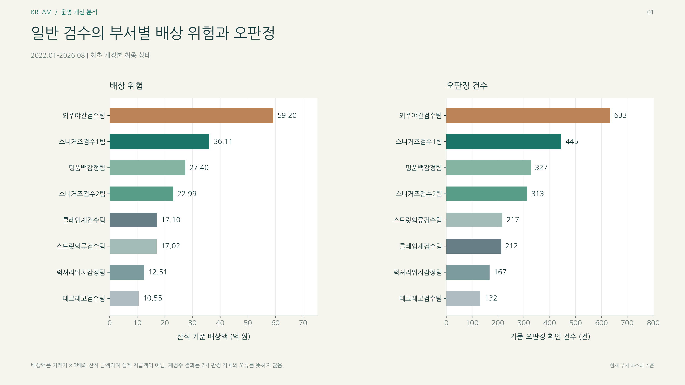
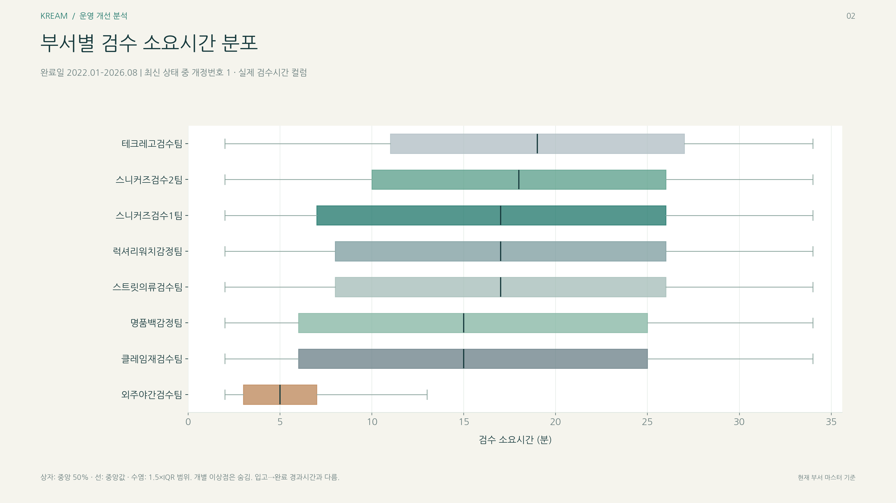
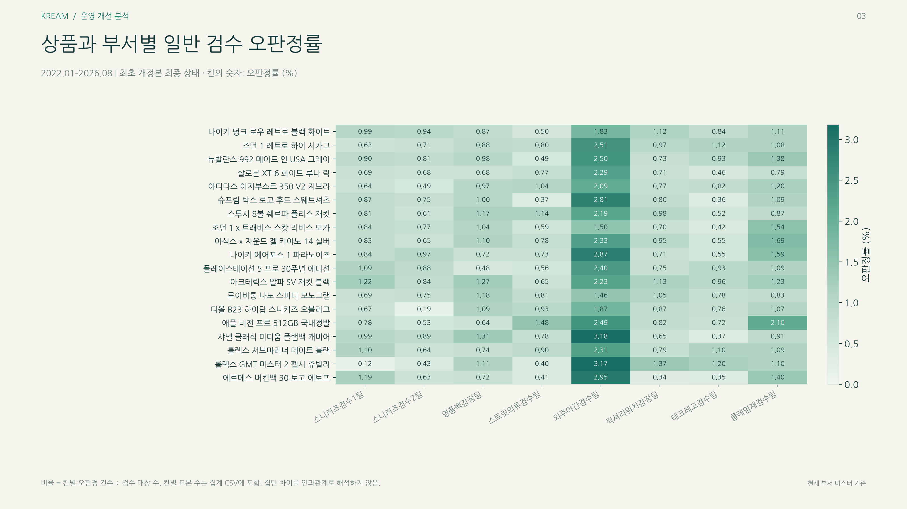
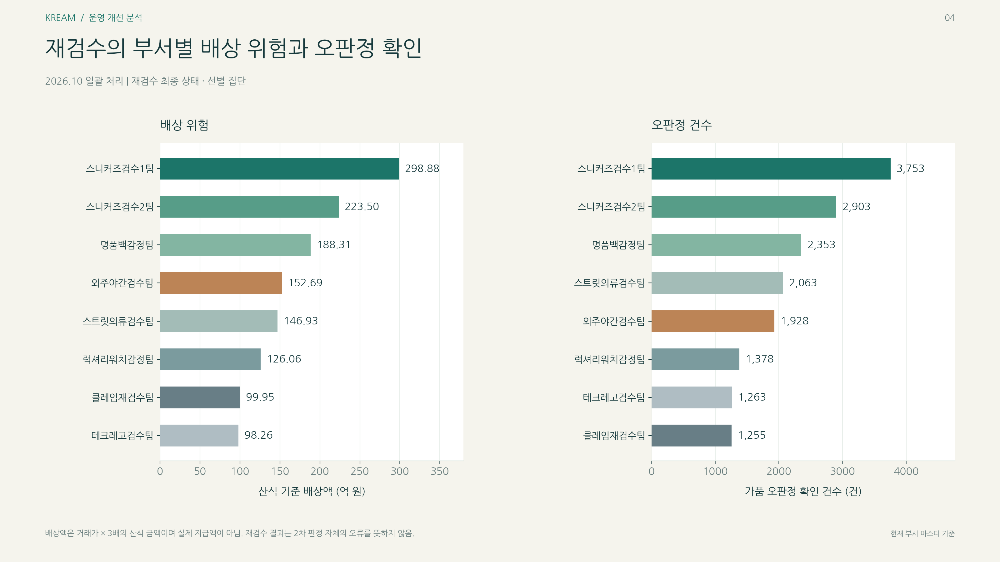
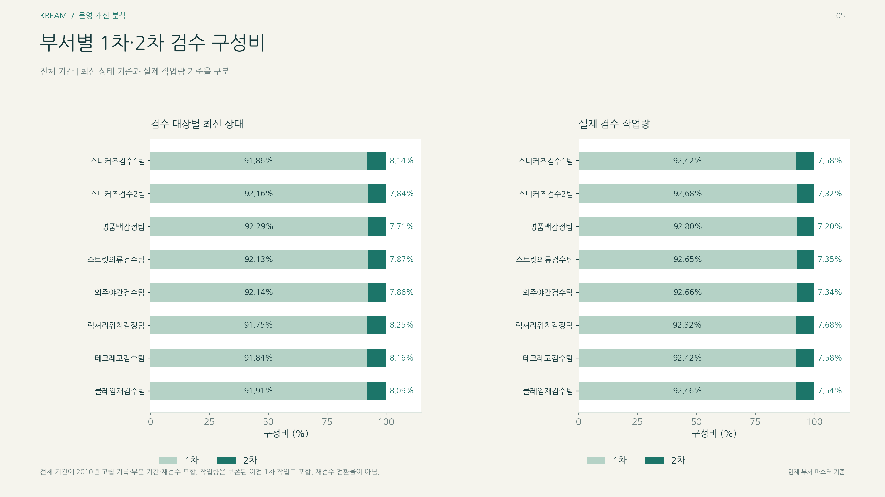
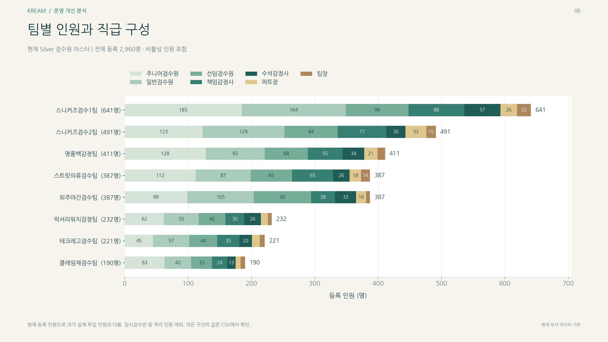
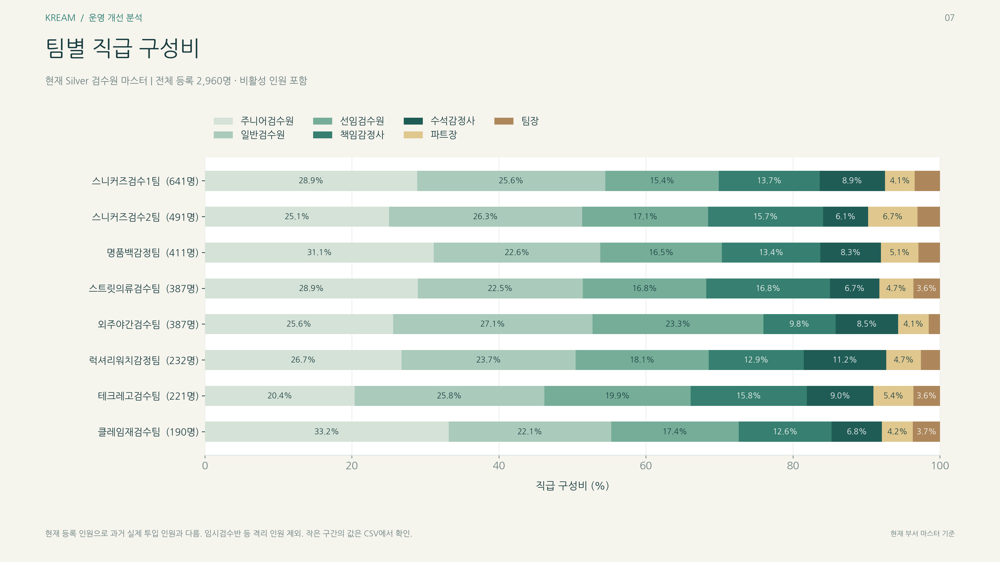
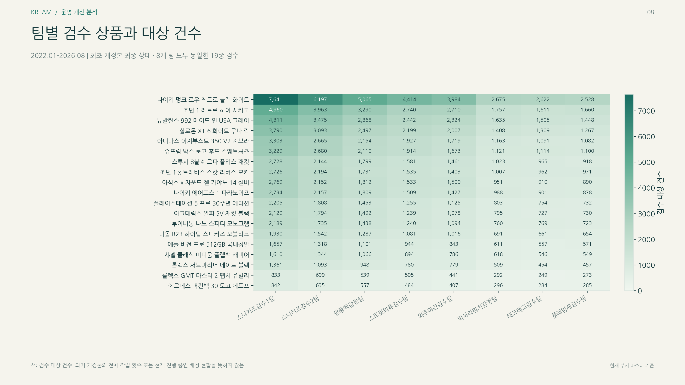
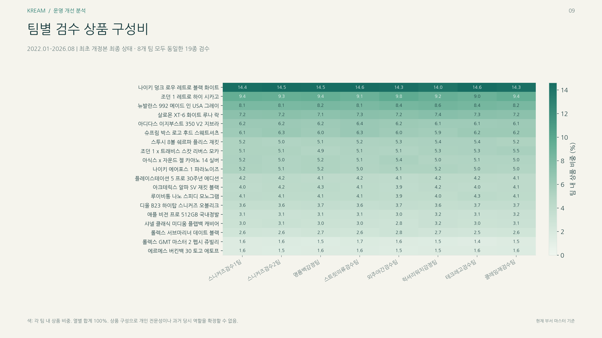
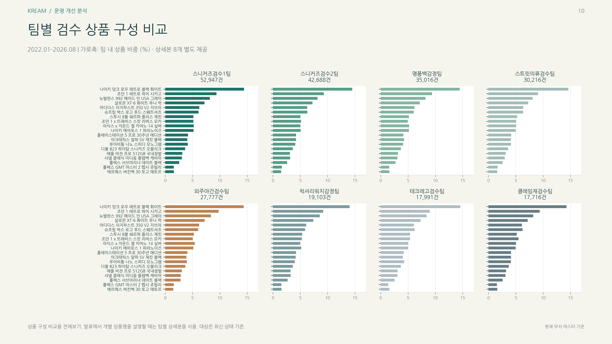

# 운영 분석과 시각화 근거

## 분석 전제

제공된 합성 데이터에서 관측한 값이다. 배상액은 판정 코드가 CLAIM_FAKE_PASS인 행의 거래가 × 3 산식이며 실제 지급액이 아니다. 부서는 현재 정상 마스터 소속이다. 컨설팅은 발표를 위한 상황 가정이다.

## 기간과 분모

| 분석 | 필터 | 분모 |
| --- | --- | --- |
| 일반 검수 | 최종 Silver, REV_NO=1, 2022-01-01 이상 2026-09-01 미만 | 243,454 |
| 재검수 | 최종 Silver, REV_NO>=2, 2026-10-01 이상 2026-11-01 미만 | 21,656 |
| 현재 상태 비중 | 전체 최종 Silver | 271,787 |
| 작업 이력 비중 | 중복·오류를 뺀 모든 유효 최초·재검수 | 291,548 |
| 인원·직급 | 정상 검수원 마스터의 Y와 N 모두 | 2,960 |

## 일반 검수의 부서별 수치

| 부서 | 검수 | 가품 오판정 코드 | 산식 배상액(억원) | 판정 비율(%) |
| --- | --- | --- | --- | --- |
| 럭셔리워치감정팀 | 19,103 | 167 | 12.51 | 0.8742 |
| 명품백감정팀 | 35,016 | 327 | 27.40 | 0.9339 |
| 스니커즈검수1팀 | 52,947 | 445 | 36.11 | 0.8405 |
| 스니커즈검수2팀 | 42,688 | 313 | 22.99 | 0.7332 |
| 스트릿의류검수팀 | 30,216 | 217 | 17.02 | 0.7182 |
| 외주야간검수팀 | 27,777 | 633 | 59.20 | 2.2789 |
| 클레임재검수팀 | 17,716 | 212 | 17.10 | 1.1967 |
| 테크레고검수팀 | 17,991 | 132 | 10.55 | 0.7337 |

## 재검수의 부서별 수치

| 부서 | 재검수 | 오판정 확인 코드 | 산식 배상액(억원) | 비율(%) |
| --- | --- | --- | --- | --- |
| 럭셔리워치감정팀 | 1,766 | 1,378 | 126.06 | 78.0294 |
| 명품백감정팀 | 3,012 | 2,353 | 188.31 | 78.1208 |
| 스니커즈검수1팀 | 4,804 | 3,753 | 298.88 | 78.1224 |
| 스니커즈검수2팀 | 3,733 | 2,903 | 223.50 | 77.7659 |
| 스트릿의류검수팀 | 2,655 | 2,063 | 146.93 | 77.7024 |
| 외주야간검수팀 | 2,448 | 1,928 | 152.69 | 78.7582 |
| 클레임재검수팀 | 1,601 | 1,255 | 99.95 | 78.3885 |
| 테크레고검수팀 | 1,637 | 1,263 | 98.26 | 77.1533 |

## 짧은 검수시간 비중

| 부서 | 일반 검수 | 10분 미만 | 비중(%) |
| --- | --- | --- | --- |
| 럭셔리워치감정팀 | 19,103 | 5,252 | 27.4931 |
| 명품백감정팀 | 35,016 | 12,325 | 35.1982 |
| 스니커즈검수1팀 | 52,947 | 16,113 | 30.4323 |
| 스니커즈검수2팀 | 42,688 | 10,169 | 23.8217 |
| 스트릿의류검수팀 | 30,216 | 8,068 | 26.7011 |
| 외주야간검수팀 | 27,777 | 26,014 | 93.6530 |
| 클레임재검수팀 | 17,716 | 6,384 | 36.0352 |
| 테크레고검수팀 | 17,991 | 3,763 | 20.9160 |

외주팀 이외의 28.78%는 다른 부서의 비율을 단순 평균한 값이 아니라, 해당 행을 합쳐 계산한 가중 비율이다.

## 제공받은 10개 시각화

### 01. 일반 검수 부서별 위험

일반 검수 기간·REV_NO=1. 산식 배상액과 판정 코드 건수

[재계산 원자료](../reports/team_analysis/general_department_risk.csv)

### 02. 검수 소요시간 분포

일반 검수. 상자그림은 분포이며 시간과 오류의 인과를 입증하지 않음

[재계산 원자료](../reports/team_analysis/general_duration_distribution.csv)

### 03. 상품·부서별 일반 검수 오판정률

상품·부서별 오판정 코드 건수 / 해당 상품·부서 검수 건수 × 100

[재계산 원자료](../reports/team_analysis/product_department_error_rate_pct.csv)

### 04. 재검수 부서별 배상 위험과 오판정 확인

2026.10월 재검수. 재검수 자체의 오류율과 구분

[재계산 원자료](../reports/team_analysis/reinspection_department_risk.csv)

### 05. 최초·재검수 구성비

왼쪽은 현재 상태, 오른쪽은 유효 작업 이력. 오른쪽 CSV는 valid_workload_mix_pct.csv

[재계산 원자료](../reports/team_analysis/latest_revision_mix_pct.csv)

### 06. 팀별 등록 인원과 직급

마스터의 비재직자도 포함. 실제 출근·근무 인원과 구분

[재계산 원자료](../reports/team_analysis/department_position_counts.csv)

### 07. 팀별 직급 구성비

부서별 직급 인원 / 해당 부서 등록 인원 × 100

[재계산 원자료](../reports/team_analysis/department_position_share_pct.csv)

### 08. 팀별 상품 검수 건수

일반 검수 범위의 상품·부서 교차 건수

[재계산 원자료](../reports/team_analysis/product_department_counts.csv)

### 09. 팀별 상품 구성비

각 상품 건수 / 해당 부서 전체 일반 검수 건수 × 100. 열 합계 100%

[재계산 원자료](../reports/team_analysis/product_department_share_pct.csv)

### 10. 팀별 상품 구성 비교

09번과 같은 범위를 부서별 패널로 표시

[재계산 원자료](../reports/team_analysis/product_department_share_pct.csv)

## 개선안과 검증할 지표

| 과제 | 제안 | 확인할 지표·추가 자료 |
| --- | --- | --- |
| 외주팀 점검 | 필수 체크리스트·추가 확인·표본 감사 | 판정 변화·시간·독립 감사 정답 |
| 재검수 부담 | 최초와 재검수 담당자 연결·반복 사유 교육 | 실제 담당자·판정 연결·대기시간 |
| 품목 전문화 | 품목별 전문 셀·독립 클레임 기능 | 역량·배정·근무표·당시 소속·품질·대기시간 |

제안의 효과를 이미 관측한 절감액처럼 표시하지 않는다. CLAIM 메모와 현재 부서만으로 실제 이관 경로를 확정하지 않는다. 상품 모델 코드는 개별 실물 식별자가 아니다.

## 숫자 재확인

`src/verify_team_analysis.py`로 기간·분모별 수치를 재계산했다. 제시된 부서별 건수와 표시 금액, 핵심 비율, 마스터 인원, 작업 이력 대사 등 68개 검사를 통과했다. 상품·부서 교차 건수와 오판정 수는 groupby와 crosstab 두 경로로 다시 비교했다. 원본 이미지는 편집하지 않았으며 숫자 근거는 함께 제공한 CSV로 추적한다.