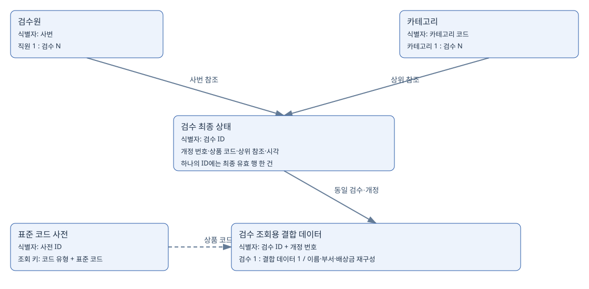

# TO-BE 모델 상세

## 개념 모델

## 논리 모델

## 물리 모델

기준 정보는 마스터로 분리하고 검수는 ID와 사번·카테고리 참조로 연결한다. 분석용 결합 테이블은 정상 마스터에서 재구성한다. 현재 상태를 한 건으로 유지하는 고유키와 개정을 식별하는 복합 기본키의 역할을 구분한다.

## 실제 제약조건 집계

| 유형 | 개수 |
| --- | --- |
| PRIMARY KEY | 28 |
| UNIQUE | 9 |
| CHECK | 13 |
| FOREIGN KEY | 4 |
| 합계 | 54 |

제약조건은 54개이며 메타데이터 행은 71개다. 복합키의 컬럼별 행과 CHECK의 저장 방식을 반영한 차이다. 문서화 대상 28개 테이블은 DB의 모든 중간 뷰와 Bronze 테이블을 포함한 총 객체 수와 다르다.

## 문서화 대상 테이블

| 테이블 | 역할 | 목적 |
| --- | --- | --- |
| asis_inspection_join_row_pair_v1 | TRACEABILITY | 검수 원본과 조인 원본 사이의 동일 공유 내용에 따른 행 대응 |
| asis_join_ready_disposition_snapshot_v1 | TRACEABILITY | 조인 원본 각 행의 정상 격리 제외 분류와 검수 원본 대응 |
| data_quality_check_results_v1 | QUALITY | 품질 검사 결과와 미검증 항목 및 기준 건수 차이 기록 |
| excluded_category_parent_lookup | EXCLUDED | 중복 등의 사유로 정상 마스터 적재에서 제외한 카테고리 기록 |
| excluded_inspection | EXCLUDED | 동일 내용 중복과 정상 이전 개정으로 최종 상태에서 제외한 검수 기록 |
| excluded_inspector_master | EXCLUDED | 중복 등의 사유로 정상 마스터 적재에서 제외한 검수원 기록 |
| gold_department_risk_summary_v1 | GOLD_ANALYSIS | 현재 마스터 부서별 최종 유효 검수의 가품 오판정과 배상금 |
| gold_inspection_result_daily_v1 | GOLD_ANALYSIS | 최종 유효 검수의 날짜별 판정과 거래가 및 배상금 집계 |
| gold_inspection_workload_daily_v1 | GOLD_ANALYSIS | 정상 이전 개정을 포함한 날짜별 최초 검수 및 재검수 작업량 |
| gold_inspection_workload_hourly_v1 | GOLD_ANALYSIS | 완료 날짜와 시간대 및 현재 마스터 부서 기준 검수 작업량 |
| gold_prediction_actual_daily_v1 | EVALUATION | 예측 입력과 분리해 저장한 평가 기간의 날짜별 실제 검수 작업량 |
| gold_prediction_input_daily_v1 | PREDICTION_INPUT | 예측 입력 상세의 날짜별 검수 건수와 소요시간 집계 |
| gold_prediction_input_record_v1 | PREDICTION_INPUT | 예측 기준일 이전 추출 조건을 충족한 최근 28일의 정상 최초 검수 상세 |
| gold_product_risk_summary_v1 | GOLD_ANALYSIS | 상품별 최종 유효 검수의 가품 오판정과 배상금 및 관측 상태 |
| gold_risk_cross_summary_v1 | GOLD_ANALYSIS | 상품 부서 최종 개정 유형 및 분석 기간별 위험 교차 집계 |
| gold_staffing_scenario_v1 | STAFFING_SCENARIO | 한 명의 검수 가능 시간을 가정한 최초 검수 필요 인원 시나리오 |
| gold_workload_forecast_evaluation_v1 | EVALUATION | 예측 방법과 날짜별 예측값 및 실제값과 오차 |
| gold_workload_forecast_summary_v1 | EVALUATION | 예측 방법별 주간 합계와 건수 및 소요시간의 MAE와 WAPE |
| gold_workload_forecast_v1 | PREDICTION | 최근 28일 평균과 같은 요일 평균으로 생성한 7일 예측값 |
| quarantine_category_parent_lookup | QUARANTINE | 정상 기준을 충족하지 못해 격리한 카테고리 원본 기록 |
| quarantine_inspection | QUARANTINE | 품질 오류와 동일 개정 충돌 등으로 격리한 검수 기록 및 원본 값 |
| quarantine_inspector_master | QUARANTINE | 정상 기준을 충족하지 못해 격리한 검수원 원본 기록 |
| silver_category_parent_lookup | SILVER_MASTER | 정제된 카테고리 코드와 이름 및 분류 단계 |
| silver_inspection | SILVER_FACT | 검수 ID별 최종 유효 개정과 정제된 검수 정보 |
| silver_inspection_correction_log | TRACEABILITY | 정상 검수와 조인 결과의 컬럼별 원본 값 및 수정 값과 적용 규칙 |
| silver_inspection_join_ready | SILVER_FACT | 최종 유효 검수에 정규 마스터 정보를 연결하고 배상금을 재계산한 결과 |
| silver_inspector_master | SILVER_MASTER | 정제된 검수원 정보와 현재 마스터 기준 부서 및 재직 상태 |
| silver_product_std_dict | SILVER_MASTER | 상품과 검수 결과 등의 표준 코드 및 금지 값 기준 |

## 실제 키·관계·CHECK

| 테이블 | 제약 이름 | 유형 | 컬럼 | 참조 또는 검사식 |
| --- | --- | --- | --- | --- |
| asis_inspection_join_row_pair_v1 | PRIMARY | PRIMARY KEY | inspection_bronze_row_id |  |
| asis_inspection_join_row_pair_v1 | uq_join_ready_row | UNIQUE | join_ready_bronze_row_id |  |
| asis_join_ready_disposition_snapshot_v1 | PRIMARY | PRIMARY KEY | join_ready_bronze_row_id |  |
| asis_join_ready_disposition_snapshot_v1 | ck_join_disposition | CHECK |  | (`disposition` in (_utf8mb4\'SILVER\',_utf8mb4\'QUARANTINE\',_utf8mb4\'EXCLUDED\')) |
| asis_join_ready_disposition_snapshot_v1 | uq_join_disposition_inspection | UNIQUE | inspection_bronze_row_id |  |
| data_quality_check_results_v1 | PRIMARY | PRIMARY KEY | check_id |  |
| excluded_category_parent_lookup | PRIMARY | PRIMARY KEY | source_bronze_row_id |  |
| excluded_inspection | PRIMARY | PRIMARY KEY | bronze_row_id |  |
| excluded_inspector_master | PRIMARY | PRIMARY KEY | source_bronze_row_id |  |
| gold_department_risk_summary_v1 | PRIMARY | PRIMARY KEY | department_name |  |
| gold_inspection_result_daily_v1 | PRIMARY | PRIMARY KEY | done_date_kst |  |
| gold_inspection_workload_daily_v1 | PRIMARY | PRIMARY KEY | done_date_kst, event_type |  |
| gold_inspection_workload_hourly_v1 | PRIMARY | PRIMARY KEY | done_date_kst, done_hour_kst, department_name, event_type |  |
| gold_inspection_workload_hourly_v1 | ck_gold_workload_hour | CHECK |  | (`done_hour_kst` between 0 and 23) |
| gold_prediction_actual_daily_v1 | PRIMARY | PRIMARY KEY | inspection_date |  |
| gold_prediction_input_daily_v1 | PRIMARY | PRIMARY KEY | inspection_date |  |
| gold_prediction_input_record_v1 | PRIMARY | PRIMARY KEY | source_bronze_row_id |  |
| gold_product_risk_summary_v1 | PRIMARY | PRIMARY KEY | item_std_code |  |
| gold_risk_cross_summary_v1 | PRIMARY | PRIMARY KEY | item_std_code, department_name, final_revision_type, analysis_period |  |
| gold_staffing_scenario_v1 | PRIMARY | PRIMARY KEY | forecast_method, forecast_date, scenario_name |  |
| gold_staffing_scenario_v1 | fk_staffing_forecast_v1 | FOREIGN KEY | forecast_method, forecast_date | gold_workload_forecast_v1.forecast_method, gold_workload_forecast_v1.forecast_date |
| gold_workload_forecast_evaluation_v1 | PRIMARY | PRIMARY KEY | forecast_method, forecast_date |  |
| gold_workload_forecast_summary_v1 | PRIMARY | PRIMARY KEY | forecast_method |  |
| gold_workload_forecast_v1 | PRIMARY | PRIMARY KEY | forecast_method, forecast_date |  |
| quarantine_category_parent_lookup | PRIMARY | PRIMARY KEY | source_bronze_row_id |  |
| quarantine_inspection | PRIMARY | PRIMARY KEY | bronze_row_id |  |
| quarantine_inspector_master | PRIMARY | PRIMARY KEY | source_bronze_row_id |  |
| silver_category_parent_lookup | PRIMARY | PRIMARY KEY | CAT_ID |  |
| silver_category_parent_lookup | chk_silver_category_level | CHECK |  | (`CAT_LEVEL` in (_utf8mb4\'TOP_LEVEL\',_utf8mb4\'BRAND_LINE\')) |
| silver_category_parent_lookup | uq_silver_category_source | UNIQUE | source_bronze_row_id |  |
| silver_inspection | PRIMARY | PRIMARY KEY | INSP_ID, REV_NO |  |
| silver_inspection | ck_silver_inspection_datetime | CHECK |  | ((`INBOUND_DT` <= `INSP_DONE_DT`) and (`INSP_DONE_DT` <= `EXTRACTED_AT`)) |
| silver_inspection | ck_silver_inspection_duration | CHECK |  | (`INSP_DURATION_MIN` >= 0) |
| silver_inspection | ck_silver_inspection_price | CHECK |  | (`TRADE_PRICE_KRW` >= 0) |
| silver_inspection | ck_silver_inspection_revision | CHECK |  | (`REV_NO` >= 1) |
| silver_inspection | fk_silver_inspection_category | FOREIGN KEY | PARENT_CAT_ID | silver_category_parent_lookup.CAT_ID |
| silver_inspection | fk_silver_inspection_employee | FOREIGN KEY | INSPECTOR_EMP_NO | silver_inspector_master.EMP_NO |
| silver_inspection | uq_silver_inspection_id | UNIQUE | INSP_ID |  |
| silver_inspection | uq_silver_inspection_source | UNIQUE | source_bronze_row_id |  |
| silver_inspection_correction_log | PRIMARY | PRIMARY KEY | source_name, source_bronze_row_id, column_name |  |
| silver_inspection_join_ready | PRIMARY | PRIMARY KEY | INSP_ID, REV_NO |  |
| silver_inspection_join_ready | ck_silver_join_compensation | CHECK |  | (`COMPENSATION_LOSS_KRW` = (case when (`INSP_RESULT` = _utf8mb4\'CLAIM_FAKE_PASS\') then (`TRADE_PRICE_KRW` * 3) else 0 end)) |
| silver_inspection_join_ready | fk_silver_join_inspection | FOREIGN KEY | INSP_ID, REV_NO | silver_inspection.INSP_ID, silver_inspection.REV_NO |
| silver_inspection_join_ready | uq_silver_join_inspection_id | UNIQUE | INSP_ID |  |
| silver_inspection_join_ready | uq_silver_join_source | UNIQUE | source_bronze_row_id |  |
| silver_inspector_master | PRIMARY | PRIMARY KEY | EMP_NO |  |
| silver_inspector_master | chk_silver_inspector_active | CHECK |  | (`ACTIVE_YN` in (_utf8mb4\'Y\',_utf8mb4\'N\')) |
| silver_inspector_master | uq_silver_inspector_source | UNIQUE | source_bronze_row_id |  |
| silver_product_std_dict | PRIMARY | PRIMARY KEY | DICT_ID |  |
| silver_product_std_dict | chk_silver_dictionary_banned | CHECK |  | (`BANNED_WORD_YN` in (_utf8mb4\'Y\',_utf8mb4\'N\')) |
| silver_product_std_dict | chk_silver_dictionary_multiplier | CHECK |  | (`FAKE_PENALTY_MULTIPLIER` >= 0) |
| silver_product_std_dict | chk_silver_dictionary_retail | CHECK |  | (`BASE_RETAIL_KRW` >= 0) |
| silver_product_std_dict | chk_silver_dictionary_type | CHECK |  | (`CODE_TYPE` in (_utf8mb4\'ITEM_MODEL\',_utf8mb4\'BANNED_WORD\',_utf8mb4\'INSP_RESULT\',_utf8mb4\'DEPT_STD\',_utf8mb4\'BANNED_DEPT\')) |
| silver_product_std_dict | uq_dictionary_source | UNIQUE | source_bronze_row_id |  |

## 정규화와 분석용 결합

- 직원 이름·소속·직급은 사번 기준 마스터에서 관리한다.
- 카테고리명은 카테고리 마스터에서 관리한다.
- 검수의 판정·거래가·시각은 검수에 둔다.
- 분석 편의를 위해 만든 join_ready는 원본 조인값을 무조건 복사하지 않고 재생성한다.
- 상품 사전 조회는 애플리케이션 검사로 대조한다. 논리 관계를 모두 물리 FK로 구현했다고 설명하지 않는다.

## 원본 추적

정상·격리·제외에서 원본 파일과 물리 행 번호를 추적한다. 수정 로그는 컬럼 단위여서 한 원본 행에서 여러 로그가 생길 수 있다. 로그 건수를 고유 오염 행 수로 해석하지 않는다.